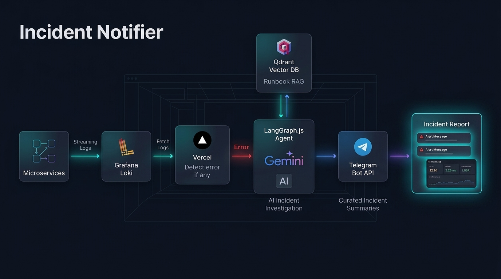

# Incident Notifier

An autonomous AI Site Reliability Engineering (SRE) agent that monitors application logs in Grafana Loki, detects errors, investigates their likely root causes using log context and internal runbooks (via Qdrant Vector RAG), and generates evidence-backed incident reports directly to your Telegram bot.



---

## 🚀 How to Run

### Step 1: Start Infrastructure Containers
Ensure Docker Desktop is running, then launch Loki and Qdrant:

```bash
docker compose up -d
```

Verify containers are running:
```bash
docker ps
```
- **Loki**: `http://localhost:3100`
- **Qdrant**: `http://localhost:6333`

---

### Step 2: Ingest Knowledge Base Runbooks

> [!IMPORTANT]
> **Demo Files Notice:** The pre-included files in `./ingest-files` (`database-config.md`, `payment-service-api.md`, `redis-cache-config.md`, etc.) are mock runbooks created **strictly for testing the sample `test-app`**.
>
> **To monitor your own real-world application:**
> 1. **Remove the demo files** from `./ingest-files/`.
> 2. **Add your own application's documentation** into `./ingest-files/` (architecture specs, database connection pool guides, third-party API timeout policies, error code catalogs, and SRE recovery procedures in `.md` or `.txt`).
> 3. **Run the ingestion script** to chunk and embed your runbooks into Qdrant Vector DB:

```bash
bun run ingest
```

You should see:
```text
[RAG] Loaded X documents from local directory "./ingest-files".
[RAG] Successfully ingested Y chunks into Qdrant collection "incident-knowledge".
```

---

### Step 3: Start the Incident Notifier Agent
Start the live monitoring process in your main terminal:

```bash
bun run start
```

The agent will connect to Loki and listen for incoming errors.

---

### Step 4: Simulate Application Traffic & Errors
In a **second terminal**, start the test application:

```bash
bun run test-app
```

The test app runs an automated traffic simulation emitting logs to Loki every 2.5 seconds with periodic errors.

You can also manually trigger specific error scenarios via HTTP:
```bash
# PostgreSQL connection refusal (ECONNREFUSED)
curl -X POST http://localhost:4000/simulate/db-error

# Payment Gateway 504 Timeout
curl -X POST http://localhost:4000/simulate/payment-timeout

# Redis ETIMEDOUT
curl -X POST http://localhost:4000/simulate/redis-timeout

# Outbound Rate Limit 429
curl -X POST http://localhost:4000/simulate/rate-limit

# User Auth 401 Spike
curl -X POST http://localhost:4000/simulate/auth-spike
```

---

## 🔌 Monitoring Your Own Application

Follow these steps to connect Incident Notifier to your own microservices or production systems:

### 1. Remove Demo Runbooks & Add Your App Docs
The files currently in `./ingest-files/` are mock runbooks for the test suite. Clean them out and place your own documentation in `./ingest-files/`:
```bash
# Clean out test-app demo runbooks
rm ingest-files/*.md

# Add your service documentation, architecture specs, and runbooks
cp /path/to/your-app-docs/*.md ./ingest-files/
```
Include:
- System overview, database connection pool limits, third-party API timeout thresholds.
- Known error codes, runbook recovery checklists, on-call instructions.

### 2. Embed into Qdrant Vector DB
Re-run the ingestion pipeline to chunk and store your app's runbooks:
```bash
bun run ingest
```

### 3. Stream Your Logs to Grafana Loki
Ensure your application sends logs to Grafana Loki (or your self-hosted Loki instance) formatted with structured metadata:
- Recommended labels: `service`, `level` (`info`, `warn`, `error`), and `traceId`.
- Configure your Loki credentials (`LOKI_URL`, `LOKI_USERNAME`, `LOKI_PASSWORD`) in `.env`.

### 4. Deploy or Run Locally
- **Local Monitoring Loop:** `bun run start` (continuously polls Loki and investigates novel errors).
- **Vercel Serverless Function:** Deploy via `vercel --prod` and invoke `/api/cron` periodically using Vercel Cron or an external ping.

Incident Notifier will autonomously detect errors from your application, query your specific runbooks via RAG, formulate verified facts vs hypotheses, and notify your on-call engineers on Telegram!

---

## 🛡️ Key Features

1. **Autonomous LangGraph Orchestration**:
   - Gathers log context leading up to and after the error.
   - Searches relevant runbooks for known error codes, thresholds, and recovery procedures.
2. **Evidence-Backed Root Cause Analysis**:
   - Strictly separates **Verified Facts** (directly confirmed in logs) from **Hypotheses** (architectural/probable factors).
3. **Smart Error Deduplication**:
   - Suppresses repeated identical errors within a 5-minute sliding window to avoid alert storms.
4. **Zod Schema Validation**:
   - Guarantees structured incident reports adhering to severity, service, root causes, evidence, and remediation steps.
5. **Terminal & Telegram Output**:
   - Formatted ANSI terminal boxes for on-call visibility.
   - Real-time direct messages (DM) sent straight to your personal Telegram account.

---

## 📱 Telegram Direct Message (DM) Setup

1. **Create your Bot**:
   - Talk to [@BotFather](https://t.me/BotFather) on Telegram and run `/newbot` to get your `TELEGRAM_BOT_TOKEN`.

2. **Add Bot Token in `.env`**:
   ```env
   TELEGRAM_BOT_TOKEN=123456789:ABCDefGhIJKlmNoPQRsTUVwxyZ
   ```

3. **Get your User Chat ID**:
   - Open Telegram and start a chat with your new bot (click **Start** or send `/start` or any text message).
   - Run the helper command:
     ```bash
     bun run get-chat-id
     ```
   - It will automatically fetch your User Chat ID from your message!
   - Paste it into `.env`:
     ```env
     TELEGRAM_CHAT_ID=123456789
     ```

4. **Test the Integration**:
   - Send an immediate test incident report straight to your Telegram DM:
     ```bash
     bun run test:telegram
     ```